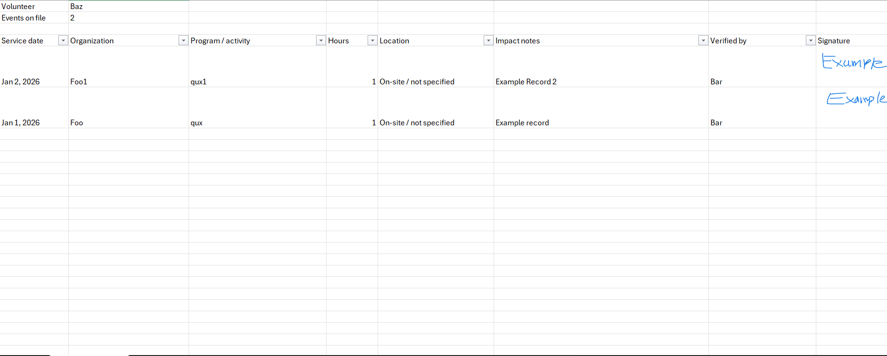

# Volunteer-Hours-Record

### Purpose
To simplify the volunteer hours process, this record serves as a web app to track the volunteer hours of volunteers with a one-year maximum (default; can be changed) history. The app is meant for representatives (admin level) to use, not the volunteer.

## Exporting Records
The web app allows the representative to download an .xlsx file of the volunteer's history on the "Service history for __" section.

The exported .xlsx file shows more recent events first.

## Login setup
**Important:** The app uses Supabase Authentication with email and password. To enable it:

1. Create a Supabase project and enable email/password sign-in.
2. Set the project URL and publishable key (or legacy anon key) in `supabase-config.js`.
3. Set the Supabase project's Site URL to where this app is hosted and add that URL to its allowed redirect URLs. Password reset links redirect back to the app.
4. Serve the app from an HTTP(S) web server rather than opening `index.html` directly.

For testing, create a separate Supabase project and set its URL and publishable/anon key in the `test` section of `supabase-config.js`. Use the **Use test configuration** button on the sign-in screen to switch projects; the selection is saved in this browser and takes effect after the page reloads. The button switches back to the live configuration. Keep test and live projects separate to avoid using production accounts while testing.

The Supabase URL and publishable/anon key are public client settings; never put a Supabase service-role key in this file. Login gates the app interface, but does not secure browser-local data: service records remain in this browser's local storage and are not synced or access-controlled by Supabase. Anyone with access to the same browser profile can access its local data.

## License
Distributed under the [MIT LICENSE](LICENSE).
